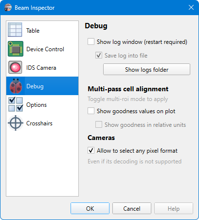

# App Preferences

## Debug

```
► File ► Preferences ► Debug
```



### Cameras

#### Allow to select any pixel format

The flag activates a debug mode in which it is possible to [choose any pixel format](./cam_settings_hard.md) provided by the camera even if it is unknown how to decode and process it. When such a format is selected, the app will receive data from the camera but not be able to display and calculate beam properties. But it's still possible to [save raw frames](./export_raw.md) for later processing, e.g., by a custom script, which is the main goal of this mode.
