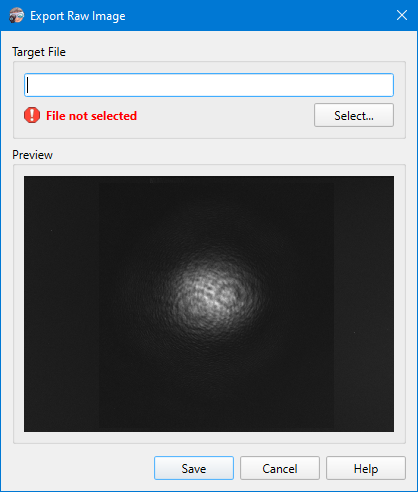

# Export Raw Image

```
► File ► Export Raw Image [F6]
```

Saves the latest captured frame into a file without any scaling and processing. Use the "Select" button to specify a target file name and image format. PNG, JPG, and PGM formats are supported. Note that JPEG images have lossy compression and are not recommended for scientific data.

In addition, images can be saved as a plain byte array, how they are received from the camera and have not been processed by the app in any way. Select the `BIRF` file extension (Beam Inspector Raw Frame) to get such a file. Note that also a `*.birf.info` file is automatically created, which contains readable information about the saved frame.

When a special debug mode is activated via [application settings](./app_settings_debug.md), the app can even receive frames that it doesn't understand how to decode. But they still can be saved for later processing, e.g., by a custom script.



## See also

- [Export plot image](./export_plot.md)
